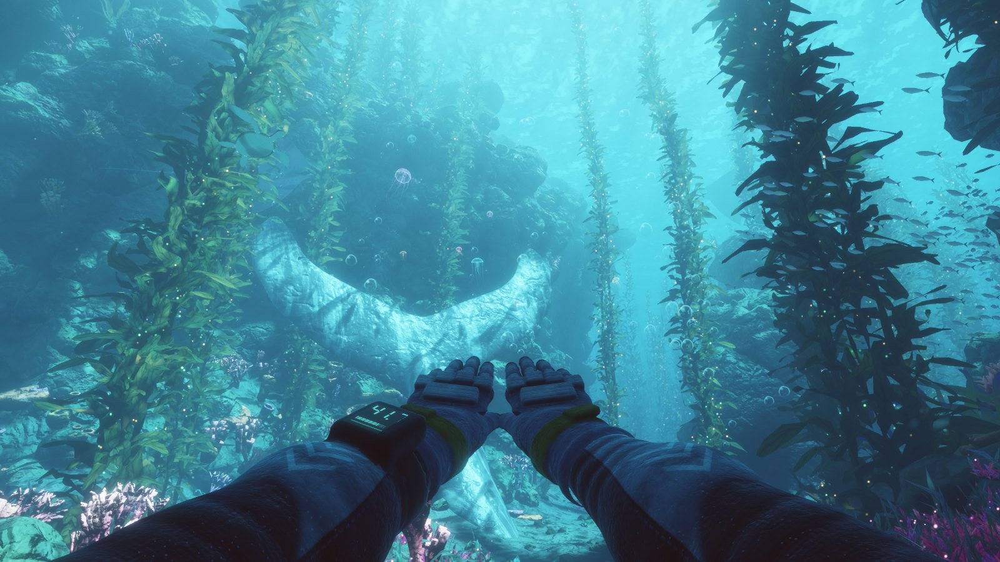
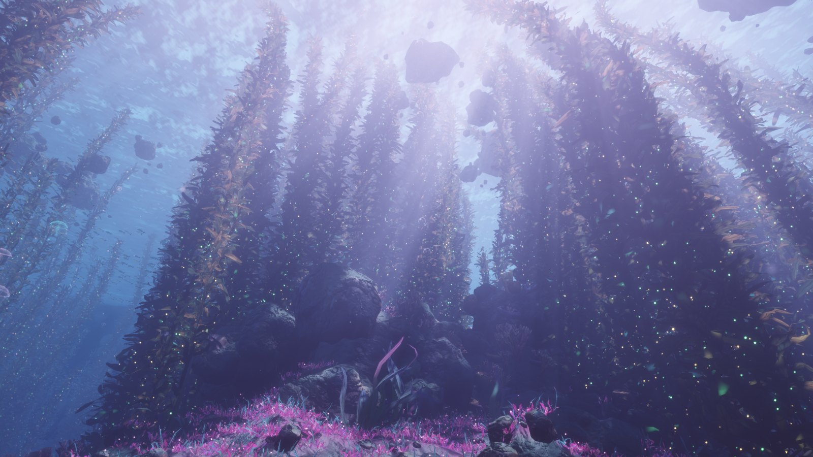
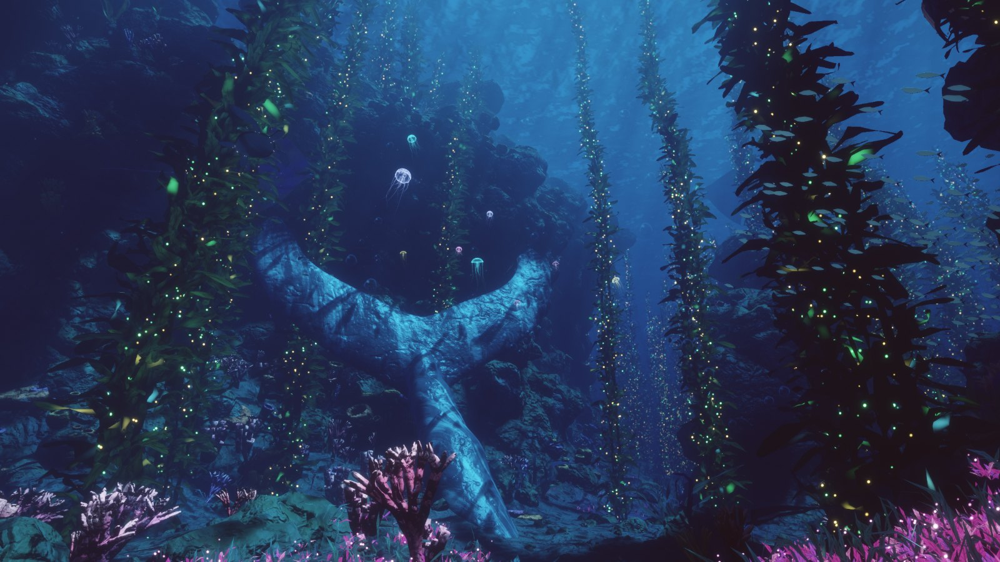
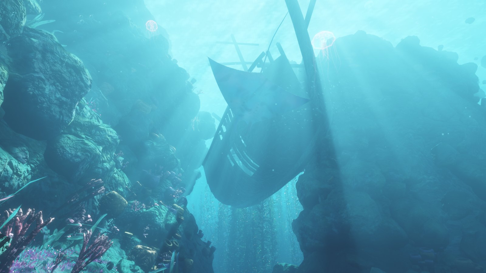
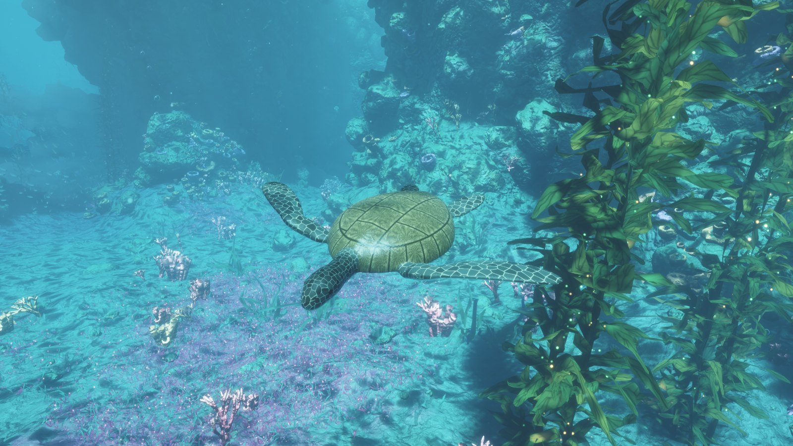
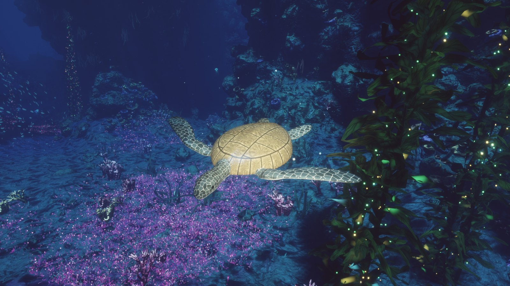

#  Hollowtide

**[Swim in it](https://richman-tan.github.io/hollowtide/)** (it needs WebGPU: a current Chrome, Edge or Safari),
or take the one file from the [latest release](https://github.com/Richman-Tan/hollowtide/releases/latest) and
open it: it needs nothing else, not even a connection.

[](https://richman-tan.github.io/hollowtide/)

An underwater world for the browser, to swim through: kelp forests, light shafts, a wreck, mantas, turtles and
jellyfish, by day, at dusk or by moonlight, and your own body in the water, from the hands that pull you along
to the fins you see when you look down. WebGPU, no engine, no asset files: the world is made as the page loads,
and the page is one HTML file.

| | | |
|---|---|---|
|  |  |  |
| Noon | Dusk | Moonlight |
|  |  |  |
| The wreck | One of three turtles | Jellyfish glow at night |
|  |  |  |
| `Shift`: the scooter | Look down: your legs | `F`: the lamp |

The world itself (its design, layout and shading) is ported from
[Abyssal Garden](https://github.com/Noniv/abyssal-garden) by Noniv (Maksymilian Dendura). Hollowtide began as a
from-scratch rebuild of that scene in a typed, modular, tested codebase; the original is kept as a reference, and
Hollowtide's world and frames are checked against it, to the checksum and to the pixel. What Hollowtide adds is
on top: an opening, loading in half the time without freezing the page, a swimmer with a body, a scooter and a
lamp, three lights, turtles and jellyfish, photo mode and a tour. Both are MIT-licensed; see `LICENSE`. [`PLAN.md`](PLAN.md)
has the plan, and [`docs/milestones.md`](docs/milestones.md) what was built in which order and how each step was
checked. The pictures here are frames of the page itself (`npm run shots:readme`).

**In this file:** [Controls](#controls) · [Running it and working on it](#running-it-and-working-on-it) · [The reference rig](#the-reference-rig) ·
[What is in it](#what-is-in-it) · [Against the original](#against-the-original) · [Known issues](#known-issues)

## Controls

Any of `W A S D` dives from the home view; then `W A S D` swim, `Q` / `E` down / up (`Space` is up as well),
`Shift` brings up the scooter and rides it, the mouse or the arrow keys look around, `1`–`6` go to the six
viewpoints, `P` photo mode (`Enter` saves a picture), `T` a guided tour, `F` the lamp, `L` a link to the view,
`Esc` opens the panel and closes it again, `M` mute, `H` stats, `C` switches between swimming with a body and
the original's steady glide. A first dive is told the few that matter, a line at a time, once the eyes are open;
the panel has the whole list.

**Every key in that list can be changed.** Press its cap in the panel, then the key that is to do its job; `Esc`
leaves it as it was. A key that already had a job swaps with it, so nothing is left without one, and one button
puts the usual keys back. What the page says afterwards (the home view's four keys, the lines at the bottom)
names the keys as they are. Keys are known by their place on the keyboard, so the same four swim on one that is
not laid out as QWERTY, and in Chrome and Edge the caps show what that keyboard has printed there.

- **Touchscreen:** hold to swim forward, slide to steer, a second finger for the scooter. Buttons in the corner
  for the lamp, the sound and the menu; the tour and photo mode are in the pause panel, and photo mode has its
  own buttons for everything its keys do. A phone held upright gets the page turned on its side, and a line
  along the bottom, the right way up, says to turn the phone; the pause panel is laid out to fit either way,
  with rows a finger can hit. (Tried in Chrome's emulation of a phone, and on a real one.)
- **Gamepad:** left stick swims, right stick looks, the bumpers go down and up, the right trigger is the scooter,
  `A` or `Start` dives, pauses and resumes, `Y` is the lamp. In the panel the d-pad or the left stick goes from
  one control to the next and moves the sliders, `A` presses, `B` closes the panel.
- **Keyboard alone:** everything is a button or a slider that `Tab` reaches, with its state said to whatever
  reads the page aloud; `Esc` opens and closes the panel.
- **Where the mouse cannot be captured** (some embeds refuse it): hold the button down on the picture and drag.
- **Where there is no WebGPU** (an older phone, a browser that has not got it yet) the page says so over a picture
  of the place, with a link to these pictures.

**A link to a view** (`L`) puts where you are and which way you look after the `#` of the address
(`#at=x,y,z,turn,tilt`, metres and degrees, then `,dusk` or `,moon` if that is the light, and `,lamp` if the
lamp is on) and copies it; whoever opens it wakes there, in that light. A link to a place inside the rock is not
followed. (The animals will be somewhere else: they do not stop for a link.)

**Another garden:** `?seed=7` (any whole number) grows other kelp, plants, corals and rocks, and other schools of
fish, on the same seabed, with the wreck, the arches and the viewpoints where they are. Without it the world is
the authored one, to the byte.

The pause panel has the settings: detail level, light, look speed, inverted look, field of view, volume, how to
swim, and what the picture is made of; buttons for the tour and photo mode; and the list of keys. Another light
is there in a fifth of a second, where you are. Another detail level makes the world again, which takes a few
seconds and says so beforehand; afterwards the panel is up again where you were.
**Swimming: with arms or classic** is the `C` key's switch, where it can be seen.
**Picture: smooth or sharp** says what gives when the machine cannot keep up: smooth trades resolution and draw
distance for sixty frames a second; sharp settles for thirty and spends the difference on pixels and distance.
**Frames** is how many are drawn a second: as many as the screen shows, or no more than sixty, or no more than
thirty, for a cooler and quieter machine. (At thirty there is time for a sharp picture whichever was chosen, so
that row cannot be pressed then.)
**Resolution** is whose the pixel count is. Auto: the page's, given up where the machine is short and taken
back where it is not. Half or full: yours, held whatever it costs, and then only the draw distance is traded.
On a phone the last two are left to the page.

**Photo mode** (`P`) stops the moment, clears the screen of everything but the world, and lets you still move
to frame it; `Z` runs the moment back and `X` runs it on while held, to have the manta where you want it;
`Enter` draws it again at twice the screen's size each way (up to 4K) and saves a PNG. A photograph can also be
given three things, each for that photograph only:

- `V` and `B` make it darker and brighter, half a stop at a time, two stops either way.
- `G` lays a grid of thirds over the picture to set it out by. The grid is the page's: a saved picture has none.
- `O` holds the focus at the distance of whatever is in the middle of the picture at that moment; what is nearer
  or further goes soft, the more the further from it, and the view can then be moved to put the sharp thing
  where it belongs. It is a thin lens: held on something close, the distance is very soft; held far off, nearly
  everything is sharp. `O` again lets go.
**The tour** (`T`) flies the camera along a scripted route through the wreck, the kelp forest and the grotto for a
minute; any swimming key takes over wherever it has got to. Where the system asks for reduced motion it flies at
half its pace, and says beforehand that the view moves by itself.

## Running it and working on it

It takes [Node](https://nodejs.org) 20 or later; the tests in a browser drive the installed Google Chrome.

```bash
npm install
npm run dev            # http://127.0.0.1:5173, rebuilds and reloads on save
npm run check          # typecheck, lint, unit tests: 20 to 40 s, no browser
npm run build          # dist/index.html: one self-contained file, size printed, 220 KiB budget enforced
open dist/index.html   # it runs from file://
```

A fresh clone can run all of that. The other scripts, and what each needs first:

| Script | What it does | Needs |
|---|---|---|
| `node tests/browser/boot.mjs` | The quickest test in a browser: both builds start and draw. About 15 s | `npm run build && npm run build:harness` |
| `node tests/browser/shell.mjs` (and `panel`, `body`, `life`, `mood`, `touch`) | Loading, keys, settings, photo mode and tour; the panel, its hints and a gamepad in it; the swimmer; turtles, jellyfish and fish; the three lights; a touchscreen | `npm run build:harness` |
| `npm run test:browser` | All of the browser tests: the ones above, and frames, checksums and swimming compared with the original. About twenty minutes, a Chrome window in view throughout | The original's data: `npm run ref:capture` and `npm run ref:dump` at each detail level (see the reference rig) |
| `npm run test:safari` | The build starts from `file://` in Safari and draws (Safari is left open on the test page) | macOS |
| `npm run shots:readme` | The pictures in this file | Nothing more |
| `npm run shots`, `npm run bench` | Frames of the original's world; the original and Hollowtide timed taking turns | The original's data; `bench` its clone as well |
| `npm run ref:build`, `ref:verify`, `ref:capture`, `ref:dump`, `ref:bench` | The reference rig, below | A clone of the original |

Three things to know before changing something:

- `npm run check` opens no browser. What the page says and does (a label, a key, a setting) is covered by the
  browser tests: after changing any of it, run `node tests/browser/shell.mjs` and `panel.mjs`, and `touch.mjs`,
  `mood.mjs`, `body.mjs` or `life.mjs` for what they cover.
- There are two sets of numbers in `src/config/tuning.ts`: the faithful one, with which the frames are the
  original's, and the tuned one, which ships. Anything new is zero or absent in the faithful set, so that the
  comparisons with the original (drawn with `?tuning=faithful`) still pass.
- The shipped file has a size budget, and the build fails over it.

Faults reported and pull requests are both welcome: [`CONTRIBUTING.md`](CONTRIBUTING.md) says what helps in a
report and what to run before sending a change.

How it is put together:

- `src/main.ts` is one bundle with two roles: the page runs it as the main thread, and the main thread starts the
  world-generation worker from a Blob of the same script. That keeps the build to a single file that also runs
  from `file://`.
- `src/gpu/struct.ts` and `src/gpu/bindings.ts` define uniform structs and bind groups once and generate both the
  WGSL declarations and the typed offsets, so shaders and the code that feeds them cannot drift apart.
- `src/shaders/*.wgsl` are real files with `#include "…"`; `tools/wgsl.mjs` resolves the includes and minifies
  them for the shipped build.
- `src/app/harness.ts` holds the hooks the browser tests use (capture a frame, feed in a dumped scene of the
  original, compare). It is compiled into `dist/index.harness.html` and the dev server only, never into
  `dist/index.html`.

For development the page can also draw a dump of the original's world instead of its own: `npm run ref:dump`
once, then `http://127.0.0.1:5173/?world=reference` (add `&level=1` or `2` for Medium or Low). `npm run shots`
saves frames to `test-results/shots/`.

## The reference rig

The original runs beside Hollowtide as an oracle. It is never edited: `tools/reference/` reads a pristine clone,
pinned to one commit in `upstream.json`, and concatenates its sources with two hook files into a local page.

```bash
git clone https://github.com/Noniv/abyssal-garden ../oss/abyssal-garden   # once; the path is in upstream.json
git -C ../oss/abyssal-garden checkout a596354eff400d458bc2aeb9bdf5e0a9734b2bcf   # the commit it is compared with
npm install
npm run ref:verify    # frozen frames + hashes, then a second load that must match byte for byte
npm run ref:dump      # the generated world and a few textures, as fixtures (about 460 MB, not committed)
npm run ref:bench     # load time, memory and frame cost on this machine
```

These drive the installed Google Chrome in a visible window (WebGPU needs the real GPU) and write to
`.cache/reference/<commit>/L<detail level>/`. Add `-- --level 1` or `-- --level 2` for Medium or Low.

## What is in it

### A picture that fits the machine

The page finds out what the machine is short of. The original's controller (and this one until now) gives up
pixels first, on the assumption that pixels are what a slow frame is made of. On the laptop this was built on
they are not: a frame takes nearly as long at a sixteenth of the pixels, because what it is short of is
geometry, and the picture ended up at 942×530 and 40 % draw distance, blurred for nothing. Now:

- When a change of pixel count buys next to nothing twice running, the pixels go back to full and stay there,
  and only the draw distance is traded.
- When the lowest settings are still far from sixty frames a second, the picture is set to Sharp and a line
  says so; set back to Smooth by hand, it stays there.
- A machine that has settled for thirty and cannot draw sixty draws every second frame, so that they come
  evenly: thirty even frames look better than forty uneven ones.
- Whoever would rather decide can: the panel's **Frames** caps what is drawn at sixty or thirty a second, and
  **Resolution** holds the pixel count at half or at all of it, leaving the controller the draw distance alone.

On that laptop: 2560×1440 at an even thirty frames a second, where it was 942×530 at an uneven forty.

With the pixels kept, what costs time at full size is worth another look. The light shafts were 13 % of a frame
at 2560×1440, marched at half the picture's size each way. Above 1920×1080 they are now marched at a third
(they are blurred afterwards in any case): 3 to 5 % off the frame, and a difference that shows only when the two
pictures are subtracted. Two things that did not survive being measured are in `PLAN.md`: fewer shadow taps for
distant rock (slower, not faster), and a cheaper water texture (it costs nothing as it is).

### The opening

Not in the original, which shows a progress bar and then a menu.

- **The descent** (`src/ui/veil.ts`): while the world is being made, a diver sinks through the water: daylight
  and its rays fade, specks stream past, a scale at the side counts the metres. How deep the diver has got is
  how far the loading has got, down to the 41.4 m at which the swimmer will wake. It is 2D drawing on a canvas
  of its own, a few milliseconds a frame; loading still never holds the page up.
- **Black**, for a moment, when the diver has sunk out of sight.
- **Home**: the world itself from a camera that drifts from the wreck in its shafts of light through the kelp
  forest and back, the title, and one thing to do: any of `W A S D` (or `Enter`, or a tap) dives. The detail
  level sits small at the bottom.
- **Waking**: the swimmer is put on the seabed and their eyes open on it: a flutter, a longer look, then wide,
  while the picture swims into focus. The arms come up as the eyes pass half open.
- `Esc` afterwards pauses on a panel over the blurred world (resume, detail level, the keys), and resuming has
  no second awakening. With reduced motion asked for, the descent stands still and counts, and the eyes simply
  fade open.

### Three lights

The same world at **noon** (the light it was made for), at **dusk** (red and gold near the surface, lavender
below, the shafts pale pink) and by **moonlight** (a twentieth of the day's light, cold blue, and what lives
here shining in it: the jellyfish, the specks among the kelp, the magenta ground cover). Pick one on the home
view or in the pause panel: the world goes dark for a moment and comes up again in it, with the swimmer where
they were.

- A mood is seven numbers (`src/config/mood.ts`): a colour that scales the sun's own light, a colour that scales
  the daylight the water scatters (the haze, the light from all around, the sky through the surface), how much
  living things shine by themselves, and how far the eye opens.
- **A glow that does not need the sun.** The original's glowing plants glow in proportion to the light that
  reaches them, so in the dark they would go out. The moods add a term that does not.
- **Dusk has to be far redder than a sunset.** Water takes the red out of light within a few tens of metres; a
  sun tinted like a sunset in air turns the seabed green. For any warmth to arrive, the sun's red is 2.4 times
  noon's.
- **Noon is untouched.** The numbers live in three constants the shaders share; as written they are ones and a
  zero, and the shader compiler folds them away, so noon's frames are still the original's (the parity tests are
  unchanged). Another mood rewrites those three lines when the shaders are made.
- **Changing it does not start the page over.** The shaders that have the light in them are made again while the
  picture goes on (about 0.2 s on the laptop this was built on), and all of them are put to use between one
  frame and the next. The world, the shadows and the place are untouched. A test changes the light in place and
  starts a page in it, and the two pictures are the same to the last bit.
- The sun does not move: the caustics and the baked shadows are made for where it is.

### A lamp

`F` (or a gamepad's `Y`) switches on a lamp: a cone of warm light, 31 degrees either side of where you look,
that lights the rock, the plants, the fish and turtles and whatever drifts through it. It is the scooter's
headlamp while the scooter is out and a torch by the head otherwise, and by moonlight it starts switched on.

- It is one small block of numbers every scene shader can read (`src/render/lamp.ts`, `lampLight` in
  `src/shaders/common/scene.wgsl`): where it is, which way it points, how bright. Each shader adds it to what it
  drew: rock that fluoresces answers with more than it is given, a fish flashes silver, a blade of kelp is lit
  through from behind.
- It fades with the square of the distance and with the water in between, which takes its red first: about four
  times the noon sun at three metres, and still more than half of it at ten, which is where one points it.
- It is not at the eye. Light from exactly where one looks from shows no shape.
- Off, the shaders skip it: the picture is what it was to the last bit (checked in the test).

### Jellyfish

The original has none. Here about a hundred drift in groups along the tour's route and ahead of the place you
wake: bells from a hand's width to a metre across, in four colours, each squeezing and opening to its own beat,
climbing a little with every squeeze, trailing eight hair-thin tentacles and four frilled arms.

- **No mesh.** A jelly is 32 bytes. The vertex shader builds the bell, the tentacles and the arms from the vertex
  index, the way the leaves are built (`src/shaders/jelly.wgsl`).
- **Light, added.** They are drawn last and add their light to the picture: a thin shell is brightest seen edge
  on, so the bell shows as a bright outline with canals down it, a lit rim and four rings at its top. Sunlight
  makes them shine where it reaches; their own glow is there regardless, so they show in the dark of the grotto.
- **Tentacles never thinner than a pixel.** Far away a tentacle is far thinner than a pixel, and would come and go
  between samples. It is drawn a pixel wide and that much dimmer instead.
- **Only in open water.** Each is placed where the collision field says there is a metre of water all round the
  loop it drifts on (`src/world/jellies.ts`); they are not part of the generated world, whose output stays the
  original's to the byte.
- They cost nothing that can be measured on this machine (within ±4 ms noise of zero, in alternating turns).

### Turtles

Three green sea turtles, each rowing round its own loop of open water: one near where you wake, two along the
tour's route.

- **Sculpted, not modelled.** The mesh is made the way the swimmer's hands are: a distance function (a domed
  shell, four flat blades, a neck and head) meshed with surface nets when the page loads, 22,000 vertices, in the
  worker that builds the swimmer's body (`src/life/turtle.ts`).
- **Rowed without bones.** Each vertex knows which limb moves it and how much. The vertex shader turns the front
  flippers about the shoulder (up and forward, then down and back, the tip following the root, the blade edge on
  to the water on the way down), sculls the rear ones and turns the head, all as functions of time; the body
  rises with each down beat (`src/shaders/turtle.wgsl`).
- **Drawn on.** The carapace's plates (five down the middle, four down each side, a ring of small ones round the
  rim) are laid out in the fragment shader, each rayed with amber from its middle; the skin is a field of
  scattered cells, dark scales with pale edges, larger on the flippers than on the head.
- **Kept out of the rock and the kelp.** A loop is used only if the collision field has open water all the way
  round it and no column of kelp stands within 2.6 m of it (the generator now also reports where each column
  stands; nothing it made before has changed).

### Fish that make way

In the original a school swims straight through the camera. Here a fish within 3.6 m of the swimmer is moved out
along the line from the eye, the more the nearer, so a school opens as you swim into it and closes behind you.
Nothing is simulated: it is one more closed-form term in the fish's vertex shader (`PART` in
`src/shaders/creatures.wgsl`), zero in the faithful tuning.

### The swimmer

Not in the original. Holding forward swims a breaststroke: the hands glide stretched out ahead, turn outwards,
press out past the edges of the view, come back under the shoulders and reach forward again from there, and the
speed surges with each pull instead of holding steady (the same ground is covered). Moving sideways, backwards, up or down is done by sculling. `Shift`
brings a scooter up from below, both hands on its handles, and it pulls at the original's fast speed wherever
you look.

- **Meshes** (`src/body/meshes.ts`, `sculpt.ts`): each arm is a wetsuit sleeve and a glove, sculpted as distance
  functions (a few dozen rounded shapes melted together) and meshed with surface nets, like the whale tail. The
  hand has a bone to each knuckle melted into a palm, fingers that are wider than thick with knuckles on the
  back, creases on the palm side and a pad under the tip, moulded guards over the knuckles, pads along the
  fingers and a wrist strap; the left forearm carries a dive computer. How much of the surrounding light each
  vertex's own shape blocks is baked in when it is sculpted, so the gaps between fingers are dark for free.
- **Skeleton** (`src/body/skeleton.ts`): 19 bones an arm: upper arm, forearm, hand, three bones a finger and
  three for the thumb. Each vertex follows one or two of them, so elbows, wrists and knuckles bend without a
  seam. An arm is posed from what its hand should do: where the wrist is, which way the fingers point and the
  palm faces, how the fingers are held. The elbow always goes out and down, so the arms come into the picture
  from its lower corners, where shoulders are.
- **Surface** (`src/shaders/body.wgsl`): the arms have to stand next to rock that is textured at four scales, so
  they use the same detail texture, taken along three axes at three scales for wear, grain and tooth, and real
  relief worked out as a height and lit as a slope: folds where the suit bunches at the elbow and the cuff, the
  seam of the forearm panel with its stitches, the ribs of the glove's knit, rubber studs on the palm, scored
  pads, webbing. Tiny bubbles cling to the suit. The dive computer shows the real depth. Sun, shadow map,
  caustics, ambient light and fog are the world's own.
- **Motion** (`src/body/rig.ts`): the stroke is eight key poses joined by a smooth closed curve, lingering in
  the glide and quick through the pull; the hands follow it with a little give, hang back from a turning view,
  and are never quite the same from stroke to stroke. The view nods on the pull. A test follows every bone
  through the stroke in thousandths and allows none to jump.
- **Lens**: the body is posed in view space and drawn first, in the nearest tenth of the depth range, so a rock
  the swimmer is pressed against cannot cut through a hand; and through a longer lens than the world (51° against
  62°), which stops things at arm's length being stretched towards the edges of the picture.
- **Legs** (`src/body/legs.ts`): hang upright in the water and look down, and there they are: hips with a
  weight belt, thighs held forward and knees bent the way a diver sits in the water, pads on the knees, boots,
  and a pair of yellow fins kicking slowly to keep you there (faster when you go up, down or sideways). Swim,
  and the body lies back along its way: the legs trail behind and are gone. Four bones a leg (thigh, shin,
  foot, the far half of the blade, which bends), posed from the base of the neck in the frame the view is
  pitched in. There is no chest: someone looking down their body looks over it, and one drawn where it is
  would be most of the picture; and legs hanging straight down would be hidden under the hips.
- **Breath** (`src/body/breath.ts`): every five or six seconds, sooner when working, a run of some forty bubbles
  leaves the regulator by the cheeks and rises past the mask, with the sound of it. Each is a bubble like the
  world's own, a closed-form climb from where it was let go to the surface; hover and look up, and the trail is
  there above you. Swim, and they are behind you before you see them. The hands churn up small ones of their
  own on each pull, which sweep past the corners of the picture, and a few while they scull.
- It is sculpted in the mesh worker after the world's own meshes, and arrives when it is done: the first frame
  does not wait for it.
- `node tests/browser/body-shots.mjs` saves contact sheets of the stroke and the other poses to
  `test-results/shots/`.

Not there yet: a wash behind the propeller; the kick of a breaststroke (the legs are out of sight while
swimming, so there is none).

## Against the original

What already differs from the original, on an Apple M3 with 8 GB at High detail. `npm run bench` opens both
side by side and lets them take turns, a few dozen frames each: a laptop slows by half as it warms up, so timings
taken minutes apart cannot be compared.

| | Original | Hollowtide |
|---|---|---|
| Main thread held while loading | 3.0 s (longest task 1.7 s) | none: no task over 50 ms (see the note) |
| Load time, both measured in one sitting on a warm machine | 6.1 s | 3.6 s |
| Load time on a cool machine (separate sittings) | 3.4 s | 1.6 s |
| Peak memory while loading, page / whole browser | 1.1 GB / 1.9 GB | 0.5 GB / 1.2 GB |
| Loading bar | timed animation | real progress from the generator |
| Shipped file | 97 KiB | 211 KiB (84 KiB gzipped), with the swimmer from hands to fins, the opening, the moods, the lamp, jellyfish and turtles that the original does not have. The shader code the shaders share is in the file once and joined to each when the page starts (spliced into each, it was there eight times: 28 KiB), and the build gives the shaders' own names short ones (12 KiB) |
| Frame at 2560×1440, six viewpoints | 45.7 / 35.4 / 26.9 / 38.5 / 35.9 / 35.7 ms | the same within 3 % |
| Frame at 640×360, six viewpoints | 26.2 / 19.1 / 19.6 / 20.3 / 21.2 / 19.2 ms | the same within 3 % |
| 60 s fly-through at 2560×1440, average | 37.8 ms | 37.1 ms |

Where the loading time went (milestone 10), each step checked against the original's checksums:

- The meshes and the ground map need nothing from the density field, so a second worker builds them while the
  first is busy with the terrain; both start alongside shader compilation instead of after it.
- Two things took half of the generator's time. One was the test "is this point near the camera's path", made
  for every plant and rock against all 606 points of the path: the points now sit in a grid, and the test looks
  at the few nearby. The other was `Math.hypot`, which in V8 is a general routine about nine times slower than
  the arithmetic it does: `src/math/hypot.ts` does the same arithmetic, to the bit.
- The collision field is worked out after the world has been handed over, as nothing on screen waits for it.
- `node tools/profile-generator.mjs --cpu` shows where the time goes now.

With the original's own draw distances (the faithful set, `?tuning=faithful` in a dev build) the frame costs
are still the original's; what ships is the tuned set, 13–16 % cheaper (see [the milestones](docs/milestones.md)). Both submitted exactly the same geometry (35,034,683 vertices and
indices at the first viewpoint), and that geometry, not the pixel count, is what a frame costs on this GPU. Hollowtide
now leaves out the boulders that are outside the view (they were 5.7 million of those indices, drawn
wherever the camera looked), which is worth a few per cent. `node tests/browser/profile.mjs` times a frame with
each part of the scene left out: no single part dominates (plants and glints about a third, rocks a sixth, the
fixed passes a sixth), so the larger gains need coarser meshes in the distance, which changes pixels and is a
later milestone.

Note on the long tasks: the shell test (1280×720) and eight of nine loads measured at 2560×1440 had none. One
load, on a hot machine with the original open in a second browser, had a single task of 455 ms; it did not
happen again in six attempts to reproduce it, three of them under the same conditions. The benchmark now records
when a long task starts and which loading message was up, so the next one can be placed.

### Baseline: the original on an Apple M3, 8 GB (High detail, Chrome 157)

| | |
|---|---|
| Load | 3.7 s, of which the main thread is blocked for 3.2 s (longest single task 1.7 s) |
| Peak memory while loading | 1.0 GB in the page's process, 1.6 GB for the browser in total |
| Frame cost at 2560×1440 | 28–47 ms at the six viewpoints; 39 ms on average along the fly-through (26 fps) |
| Frame cost at 1280×720 | 23–33 ms; 27 ms on average along the fly-through |
| Frame cost at 640×360 | 20–28 ms |
| Where its dynamic resolution ends up | 942×530 at 40 % draw distance, the lowest it can go (Hollowtide now: 2560×1440 at 40 %, thirty even frames a second) |

Frame cost is measured by running frames one at a time and waiting for the GPU to finish each. A frame costs about
20 ms however few pixels it has, so on this machine the scene is bound by geometry, not by resolution, and lowering
the resolution cannot reach 60 fps. Hollowtide's controller now finds that out for itself (see the settings, above).

The reference world at High: 808k terrain vertices, 2.17M leaves and plants, 629k glints, 68k rocks and pebbles,
18k sponges and corals, 18k bubbles, 4,240 fish, 6 mantas.

## Known issues

Known issue, inherited from the original: at Low detail (no anti-aliasing), and now and then at Medium, the scene
is not exactly repeatable from one render to the next on this Apple GPU. A few hundred isolated pixels on the
plants change while the depth buffer stays identical. Two loads of the original differ by up to 722 pixels in a
frame (`tests/browser/noise.mjs` measures it), and Hollowtide behaves the same way, so the Low comparison allows
0.2 % of pixels to differ. Ruled out so far: the blended draws, the fish, shadow sampling in vertex shaders, the
sine hash, and the timing of the shadow bake. The cause has not been found.
