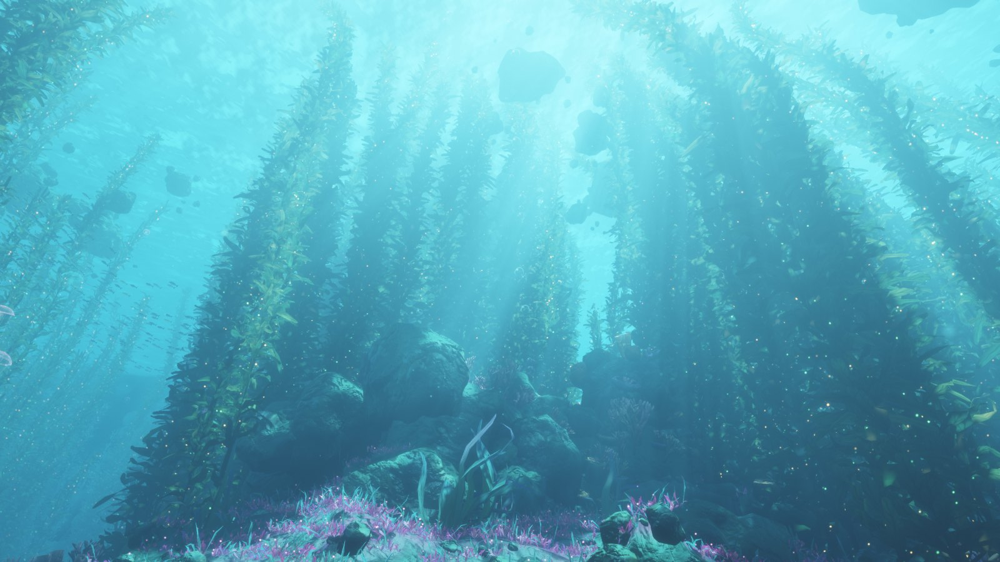
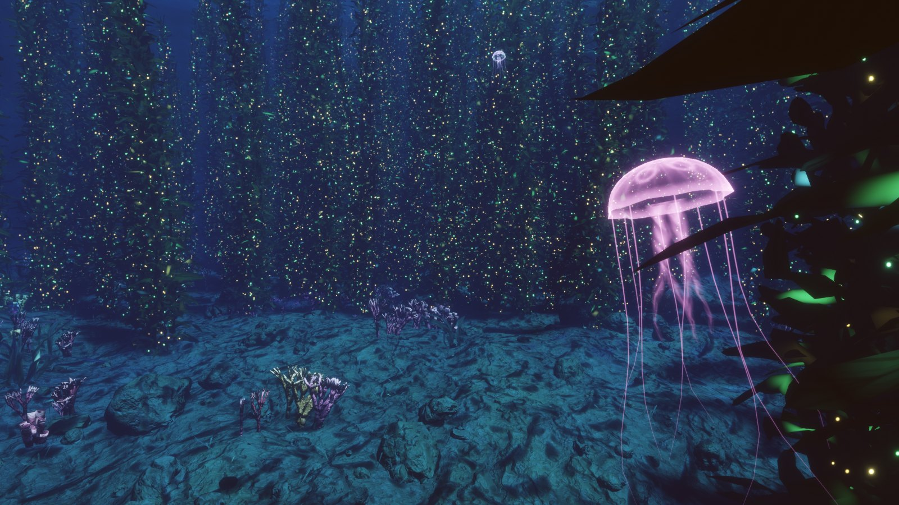
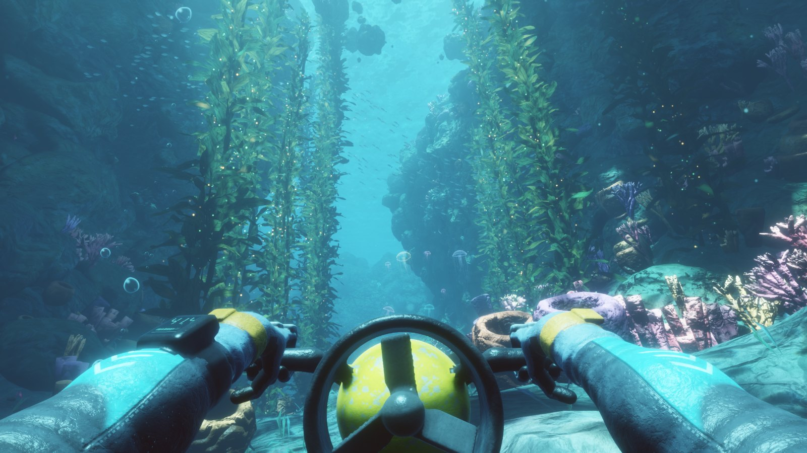
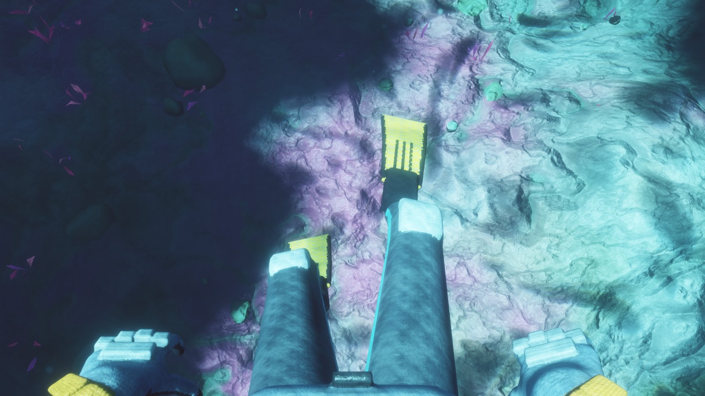

#  Hollowtide

**[Swim in it](https://richman-tan.github.io/hollowtide/)** (it needs WebGPU: a current Chrome, Edge or Safari)

[](https://richman-tan.github.io/hollowtide/)

An underwater world for the browser, to swim through: kelp forests, light shafts, a wreck, mantas, turtles and
jellyfish, by day, at dusk or by moonlight, and your own body in the water, from the hands that pull you along
to the fins you see when you look down. WebGPU, no engine, no asset files: the world is made as the page loads,
and the page is one HTML file.

| | | |
|---|---|---|
|  |  |  |
| Noon | Dusk | Moonlight |
|  |  |  |
| The wreck | One of three turtles | Jellyfish glow at night |
|  |  |  |
| `Shift`: the scooter | Look down: your legs | `F`: the lamp |

The world itself (its design, layout and shading) is ported from
[Abyssal Garden](https://github.com/Noniv/abyssal-garden) by Noniv (Maksymilian Dendura). Hollowtide began as a
from-scratch rebuild of that scene in a typed, modular, tested codebase; the original is kept as a reference, and
Hollowtide's world and frames are checked against it, to the checksum and to the pixel. What Hollowtide adds is
on top: an opening, loading in half the time without freezing the page, a swimmer with a body, a scooter and a
lamp, three lights, turtles and jellyfish, photo mode and a tour. Both are MIT-licensed; see `LICENSE`. `PLAN.md`
has the plan and the milestone list. The pictures here are frames of the page itself (`npm run shots:readme`).

## Status

Done so far:

| Milestone | What exists | How it was checked |
|---|---|---|
| 0. Reference rig | The original, driven and measured on this machine | Two separate loads give byte-identical frames and hashes |
| 1. Scaffold | TypeScript modules, single-file build with its worker, WGSL files, generated uniform layouts, tests, CI | Starts from `file://` in Chrome and Safari; layouts agree with an independent WGSL parser |
| 2. Engine core | Device, camera, frame uniforms, render targets, bloom and composite passes, capture hooks | Frame uniforms equal the original's bit for bit (18 frames); bloom is bit-identical and the composited frame differs in 0 of 921,600 pixels at all six viewpoints |

| 3. Bakes | Rock detail texture, animated water texture, sun shadow map; the world-data contract and its GPU buffers | All three equal the original's value for value (4.2M, 1.0M and 16.8M values), the shadow map baked from the original's dumped world |

| 4. Opaque scene | Rock and seabed shader, set pieces, sponges, corals, water surface, backdrop, cell culling and level of detail | Drawing the original's dumped world, all six viewpoints match its frames: at most 2 of 921,600 pixels differ, by 1/255 |

| 5. Plants and life | Kelp, plants and their glints, fish, manta rays, bubbles, drifting particles | With only the light shafts off on both sides, six viewpoints at three times each: at most 4 of 921,600 pixels differ, by 1/255 |

| 6. Light shafts, detail levels | Volumetric light shafts and their blur; Medium and Low variants; the scripted camera path | Whole frames against the original at High, Medium and Low: six viewpoints at three times each, plus 30 frames along the fly-through at High. At High and Medium at most 11 of 921,600 pixels differ, by 1/255 |

| 7. Generator, part 1 | In the worker: speck removal, collision bricks, terrain mesh, ground map, all 26 procedural meshes; on the GPU: the density field | Each output has the same SHA-256 as the original's, at all three detail levels (13 outputs, from 21 million voxels of density to the ship's planks) |

| 8. Generator, part 2 | The 14 scatter systems (kelp, plants, glints, sponges, corals, rocks, set pieces, bubbles, fish, mantas, particles), the skylight volume, packing; the page now builds its own world | All 84 outputs have the same SHA-256 as the original's at all three levels; frames drawn from the generated world pass the same comparison as milestone 6 |

| 9. Shell | Loading bar, menu, keyboard / mouse / touch, collision, dynamic resolution, detail levels and crash fallback, stats line, sound | A scripted swim of 536 frames (easing, turning, sprinting into rock and sliding along it) traces the original's path bit for bit; no main-thread task over 50 ms while loading; starts and draws in Safari 27 from `file://` |
| 10. Speed-ups that do not change a pixel | The world is built by two workers side by side and starts alongside shader compilation; the generator itself is about twice as fast; boulders outside the view are not drawn | 48 frames at High and 48 at Medium are bit-identical before and after (`tests/browser/same.mjs`); all 84 generator outputs still have the original's checksums; loading takes about 40 % less |
| 11. In the water | Your own arms in first person, swimming a breaststroke; a hand-held scooter on `Shift`; the original's glide on `C` | Frames without the body are unchanged to the bit; 18 unit tests of the skeleton and the stroke; a browser test swims, rides the scooter and switches to the glide and back |
| 12. Speed-ups that change pixels | A tuned set of draw distances beside the original's faithful one: ground cover, rock chips and pebbles and the far kelp end sooner behind the fades they already had, glints and bubbles are sorted into cells and only drawn where they can be seen, kelp blades no longer flick as their curl passes through zero; half the frames behind the pause panel; a picture controller that finds out whether the machine is short of pixels or of geometry, settles for thirty even frames a second where sixty is out of reach, and says so | A frame takes 13–16 % less at 1280×720 and 2560×1440 (6 % at 640×360), two pages taking turns; 0–6 % of pixels differ at the six viewpoints; the tests against the original draw with the faithful set and still pass |
| 13. Features | Settings in the pause panel (look speed, inverted look, field of view, volume, a smooth or a sharp picture, swimming with arms or the classic glide), photo mode, a guided tour; arrow-key look, drag-to-look, a gamepad, a sound button, a link to a view, `?seed=` | Each is driven in the shell test: the tour flies and hands over, a photo is saved larger than the screen, settings are remembered, a made-up gamepad swims and pauses, a link is followed and one into rock is not; with a seed the seabed's checksums are the authored ones and the plants' are not |
| 14. New life and new light | Jellyfish: a hundred or so, in groups along the tour's route and ahead of where you wake, pulsing and drifting, glowing by themselves in the dark of the grotto. Three sea turtles rowing round loops of open water. Schools of fish open to let the swimmer through. Three lights: noon, dusk, moonlight | Jellyfish only ever add light (no pixel darker with them than without); each turtle is found where its loop says; none placed in rock or kelp; in the faithful tuning there are none of them and the frames are the original's; each mood is picked in the menu, remembered and compiled, dusk measures violet and moonlight dark and blue against noon |
| 15. Its own name | Hollowtide: title, menu, package, storage keys (settings saved under the old key are read once), test hook, docs | The old name appears only where the original is meant: the credit, the licence, the reference rig and the tests against it |

**Parity gate: passed.** At that point Hollowtide was the original, from scratch: `dist/index.html` builds the same world (all
84 generator outputs have the original's checksums), draws the same frames (at High and Medium at most 11 of
921,600 pixels differ, by 1/255; three of four spot-checked frames are byte-identical PNG files), and swims the
same way. What is left is the part that goes beyond the original: milestones 10 to 13.

```bash
npm run build && open dist/index.html     # or: npm run dev
```

Controls: any of `W A S D` dives from the home view; then `W A S D` swim, `Q` / `E` down / up, `Shift` brings up
the scooter and rides it, the mouse or the arrow keys look around, `1`–`6` viewpoints, `P` photo mode (`Enter`
saves a picture), `T` a guided tour, `F` the lamp, `L` a link to the view, `Esc` pauses, `M` mute, `H` stats,
`C` switches between swimming with a body and the original's steady glide.

- **Touchscreen:** hold to swim forward, slide to steer, a second finger for the scooter; a sound button and a
  menu button are in the corner.
- **Gamepad:** left stick swims, right stick looks, the bumpers go down and up, the right trigger is the scooter,
  `A` or `Start` dives, pauses and resumes, `Y` is the lamp.
- **Where the mouse cannot be captured** (some embeds refuse it): hold the button down on the picture and drag.

**A link to a view** (`L`) puts where you are and which way you look after the `#` of the address
(`#at=x,y,z,turn,tilt`, metres and degrees) and copies it; whoever opens it wakes there. A link to a place
inside the rock is not followed.

**Another garden:** `?seed=7` (any whole number) grows other kelp, plants, corals and rocks, and other schools of
fish, on the same seabed, with the wreck, the arches and the viewpoints where they are. Without it the world is
the authored one, to the byte.

The pause panel has the settings: look speed, inverted look, field of view, volume, detail level, and two choices.
**Picture: smooth or sharp** says what gives when the machine cannot keep up: smooth trades resolution and draw
distance for sixty frames a second; sharp settles for thirty and spends the difference on pixels and distance.
**Swimming: with arms or classic** is the `C` key's switch, where it can be seen.

The page finds out what the machine is short of. The original's controller (and this one until now) gives up
pixels first, on the assumption that pixels are what a slow frame is made of. On the laptop this was built on
they are not: a frame takes nearly as long at a sixteenth of the pixels, because what it is short of is
geometry, and the picture ended up at 942×530 and 40 % draw distance, blurred for nothing. Now:

- When a change of pixel count buys next to nothing twice running, the pixels go back to full and stay there,
  and only the draw distance is traded.
- When the lowest settings are still far from sixty frames a second, the picture is set to Sharp and a line
  says so; set back to Smooth by hand, it stays there.
- A machine that has settled for thirty and cannot draw sixty draws every second frame, so that they come
  evenly: thirty even frames look better than forty uneven ones.

On that laptop: 2560×1440 at an even thirty frames a second, where it was 942×530 at an uneven forty.

**Photo mode** (`P`) stops the moment, clears the screen of everything but the world, and lets you still move
to frame it; `Enter` draws it again at twice the screen's size each way (up to 4K) and saves a PNG.
**The tour** (`T`) flies the camera along a scripted route through the wreck, the kelp forest and the grotto for a
minute; any swimming key takes over wherever it has got to.

### The opening

Not in the original, which shows a progress bar and then a menu.

- **The descent** (`src/ui/veil.ts`): while the world is being made, a diver sinks through the water: daylight
  and its rays fade, specks stream past, a scale at the side counts the metres. How deep the diver has got is
  how far the loading has got, down to the 41.4 m at which the swimmer will wake. It is 2D drawing on a canvas
  of its own, a few milliseconds a frame; loading still never holds the page up.
- **Black**, for a moment, when the diver has sunk out of sight.
- **Home**: the world itself from a camera that drifts from the wreck in its shafts of light through the kelp
  forest and back, the title, and one thing to do: any of `W A S D` (or `Enter`, or a tap) dives. The detail
  level sits small at the bottom.
- **Waking**: the swimmer is put on the seabed and their eyes open on it: a flutter, a longer look, then wide,
  while the picture swims into focus. The arms come up as the eyes pass half open.
- `Esc` afterwards pauses on a panel over the blurred world (resume, detail level, the keys), and resuming has
  no second awakening. With reduced motion asked for, the descent stands still and counts, and the eyes simply
  fade open.

### Three lights

The same world at **noon** (the light it was made for), at **dusk** (red and gold near the surface, lavender
below, the shafts pale pink) and by **moonlight** (a twentieth of the day's light, cold blue, and what lives
here shining in it: the jellyfish, the specks among the kelp, the magenta ground cover). Pick one on the home
view or in the pause panel; the page starts over in it.

- A mood is seven numbers (`src/config/mood.ts`): a colour that scales the sun's own light, a colour that scales
  the daylight the water scatters (the haze, the light from all around, the sky through the surface), how much
  living things shine by themselves, and how far the eye opens.
- **A glow that does not need the sun.** The original's glowing plants glow in proportion to the light that
  reaches them, so in the dark they would go out. The moods add a term that does not.
- **Dusk has to be far redder than a sunset.** Water takes the red out of light within a few tens of metres; a
  sun tinted like a sunset in air turns the seabed green. For any warmth to arrive, the sun's red is 2.4 times
  noon's.
- **Noon is untouched.** The numbers live in three constants the shaders share; as written they are ones and a
  zero, and the shader compiler folds them away, so noon's frames are still the original's (the parity tests are
  unchanged). Another mood rewrites those three lines when the shaders are made.
- The sun does not move: the caustics and the baked shadows are made for where it is.

### A lamp

`F` (or a gamepad's `Y`) switches on a lamp: a cone of warm light, 31 degrees either side of where you look,
that lights the rock, the plants, the fish and turtles and whatever drifts through it. It is the scooter's
headlamp while the scooter is out and a torch by the head otherwise, and by moonlight it starts switched on.

- It is one small block of numbers every scene shader can read (`src/render/lamp.ts`, `lampLight` in
  `src/shaders/common/scene.wgsl`): where it is, which way it points, how bright. Each shader adds it to what it
  drew: rock that fluoresces answers with more than it is given, a fish flashes silver, a blade of kelp is lit
  through from behind.
- It fades with the square of the distance and with the water in between, which takes its red first: three times
  the noon sun at three metres, a third of it at ten.
- It is not at the eye. Light from exactly where one looks from shows no shape.
- Off, the shaders skip it: the picture is what it was to the last bit (checked in the test).

### Jellyfish

The original has none. Here about a hundred drift in groups along the tour's route and ahead of the place you
wake: bells from a hand's width to a metre across, in four colours, each squeezing and opening to its own beat,
climbing a little with every squeeze, trailing eight hair-thin tentacles and four frilled arms.

- **No mesh.** A jelly is 32 bytes. The vertex shader builds the bell, the tentacles and the arms from the vertex
  index, the way the leaves are built (`src/shaders/jelly.wgsl`).
- **Light, added.** They are drawn last and add their light to the picture: a thin shell is brightest seen edge
  on, so the bell shows as a bright outline with canals down it, a lit rim and four rings at its top. Sunlight
  makes them shine where it reaches; their own glow is there regardless, so they show in the dark of the grotto.
- **Tentacles never thinner than a pixel.** Far away a tentacle is far thinner than a pixel, and would come and go
  between samples. It is drawn a pixel wide and that much dimmer instead.
- **Only in open water.** Each is placed where the collision field says there is a metre of water all round the
  loop it drifts on (`src/world/jellies.ts`); they are not part of the generated world, whose output stays the
  original's to the byte.
- They cost nothing that can be measured on this machine (within ±4 ms noise of zero, in alternating turns).

### Turtles

Three green sea turtles, each rowing round its own loop of open water: one near where you wake, two along the
tour's route.

- **Sculpted, not modelled.** The mesh is made the way the swimmer's hands are: a distance function (a domed
  shell, four flat blades, a neck and head) meshed with surface nets when the page loads, 22,000 vertices, in the
  worker that builds the swimmer's body (`src/life/turtle.ts`).
- **Rowed without bones.** Each vertex knows which limb moves it and how much. The vertex shader turns the front
  flippers about the shoulder (up and forward, then down and back, the tip following the root, the blade edge on
  to the water on the way down), sculls the rear ones and turns the head, all as functions of time; the body
  rises with each down beat (`src/shaders/turtle.wgsl`).
- **Drawn on.** The carapace's plates (five down the middle, four down each side, a ring of small ones round the
  rim) are laid out in the fragment shader, each rayed with amber from its middle; the skin is a field of
  scattered cells, dark scales with pale edges, larger on the flippers than on the head.
- **Kept out of the rock and the kelp.** A loop is used only if the collision field has open water all the way
  round it and no column of kelp stands within 2.6 m of it (the generator now also reports where each column
  stands; nothing it made before has changed).

### Fish that make way

In the original a school swims straight through the camera. Here a fish within 3.6 m of the swimmer is moved out
along the line from the eye, the more the nearer, so a school opens as you swim into it and closes behind you.
Nothing is simulated: it is one more closed-form term in the fish's vertex shader (`PART` in
`src/shaders/creatures.wgsl`), zero in the faithful tuning.

### The swimmer

Not in the original. Holding forward swims a breaststroke: the hands glide stretched out ahead, turn outwards,
press out past the edges of the view, come back under the shoulders and reach forward again from there, and the
speed surges with each pull instead of holding steady (the same ground is covered). Moving sideways, backwards, up or down is done by sculling. `Shift`
brings a scooter up from below, both hands on its handles, and it pulls at the original's fast speed wherever
you look.

- **Meshes** (`src/body/meshes.ts`, `sculpt.ts`): each arm is a wetsuit sleeve and a glove, sculpted as distance
  functions (a few dozen rounded shapes melted together) and meshed with surface nets, like the whale tail. The
  hand has a bone to each knuckle melted into a palm, fingers that are wider than thick with knuckles on the
  back, creases on the palm side and a pad under the tip, moulded guards over the knuckles, pads along the
  fingers and a wrist strap; the left forearm carries a dive computer. How much of the surrounding light each
  vertex's own shape blocks is baked in when it is sculpted, so the gaps between fingers are dark for free.
- **Skeleton** (`src/body/skeleton.ts`): 19 bones an arm: upper arm, forearm, hand, three bones a finger and
  three for the thumb. Each vertex follows one or two of them, so elbows, wrists and knuckles bend without a
  seam. An arm is posed from what its hand should do: where the wrist is, which way the fingers point and the
  palm faces, how the fingers are held. The elbow always goes out and down, so the arms come into the picture
  from its lower corners, where shoulders are.
- **Surface** (`src/shaders/body.wgsl`): the arms have to stand next to rock that is textured at four scales, so
  they use the same detail texture, taken along three axes at three scales for wear, grain and tooth, and real
  relief worked out as a height and lit as a slope: folds where the suit bunches at the elbow and the cuff, the
  seam of the forearm panel with its stitches, the ribs of the glove's knit, rubber studs on the palm, scored
  pads, webbing. Tiny bubbles cling to the suit. The dive computer shows the real depth. Sun, shadow map,
  caustics, ambient light and fog are the world's own.
- **Motion** (`src/body/rig.ts`): the stroke is eight key poses joined by a smooth closed curve, lingering in
  the glide and quick through the pull; the hands follow it with a little give, hang back from a turning view,
  and are never quite the same from stroke to stroke. The view nods on the pull. A test follows every bone
  through the stroke in thousandths and allows none to jump.
- **Lens**: the body is posed in view space and drawn first, in the nearest tenth of the depth range, so a rock
  the swimmer is pressed against cannot cut through a hand; and through a longer lens than the world (51° against
  62°), which stops things at arm's length being stretched towards the edges of the picture.
- **Legs** (`src/body/legs.ts`): hang upright in the water and look down, and there they are: hips with a
  weight belt, thighs held forward and knees bent the way a diver sits in the water, pads on the knees, boots,
  and a pair of yellow fins kicking slowly to keep you there (faster when you go up, down or sideways). Swim,
  and the body lies back along its way: the legs trail behind and are gone. Four bones a leg (thigh, shin,
  foot, the far half of the blade, which bends), posed from the base of the neck in the frame the view is
  pitched in. There is no chest: someone looking down their body looks over it, and one drawn where it is
  would be most of the picture; and legs hanging straight down would be hidden under the hips.
- **Breath** (`src/body/breath.ts`): every five or six seconds, sooner when working, a run of some forty bubbles
  leaves the regulator by the cheeks and rises past the mask, with the sound of it. Each is a bubble like the
  world's own, a closed-form climb from where it was let go to the surface; hover and look up, and the trail is
  there above you. Swim, and they are behind you before you see them. The hands churn up small ones of their
  own on each pull, which sweep past the corners of the picture, and a few while they scull.
- It is sculpted in the mesh worker after the world's own meshes, and arrives when it is done: the first frame
  does not wait for it.
- `node tests/browser/body-shots.mjs` saves contact sheets of the stroke and the other poses to
  `test-results/shots/`.

Not there yet: a wash behind the propeller; the kick of a breaststroke (the legs are out of sight while
swimming, so there is none).

What already differs from the original, on an Apple M3 with 8 GB at High detail. `npm run bench` opens both
side by side and lets them take turns, a few dozen frames each: a laptop slows by half as it warms up, so timings
taken minutes apart cannot be compared.

| | Original | Hollowtide |
|---|---|---|
| Main thread held while loading | 3.0 s (longest task 1.7 s) | none: no task over 50 ms (see the note) |
| Load time, both measured in one sitting on a warm machine | 6.1 s | 3.6 s |
| Load time on a cool machine (separate sittings) | 3.4 s | 1.6 s |
| Peak memory while loading, page / whole browser | 1.1 GB / 1.9 GB | 0.5 GB / 1.2 GB |
| Loading bar | timed animation | real progress from the generator |
| Shipped file | 97 kB | 190 kB (76 kB gzipped), with the swimmer from hands to fins, the opening, the moods, the lamp, jellyfish and turtles that the original does not have. The shader code the shaders share is in the file once and joined to each when the page starts (spliced into each, it was there eight times: 28 kB), and the build gives the shaders' own names short ones (12 kB) |
| Frame at 2560×1440, six viewpoints | 45.7 / 35.4 / 26.9 / 38.5 / 35.9 / 35.7 ms | the same within 3 % |
| Frame at 640×360, six viewpoints | 26.2 / 19.1 / 19.6 / 20.3 / 21.2 / 19.2 ms | the same within 3 % |
| 60 s fly-through at 2560×1440, average | 37.8 ms | 37.1 ms |

Where the loading time went (milestone 10), each step checked against the original's checksums:

- The meshes and the ground map need nothing from the density field, so a second worker builds them while the
  first is busy with the terrain; both start alongside shader compilation instead of after it.
- Two things took half of the generator's time. One was the test "is this point near the camera's path", made
  for every plant and rock against all 606 points of the path: the points now sit in a grid, and the test looks
  at the few nearby. The other was `Math.hypot`, which in V8 is a general routine about nine times slower than
  the arithmetic it does: `src/math/hypot.ts` does the same arithmetic, to the bit.
- The collision field is worked out after the world has been handed over, as nothing on screen waits for it.
- `node tools/profile-generator.mjs --cpu` shows where the time goes now.

With the original's own draw distances (the faithful set, `?tuning=faithful` in a dev build) the frame costs
are still the original's; what ships is the tuned set, 13–16 % cheaper (see the status table). Both submitted exactly the same geometry (35,034,683 vertices and
indices at the first viewpoint), and that geometry, not the pixel count, is what a frame costs on this GPU. Hollowtide
now leaves out the boulders that are outside the view (they were 5.7 million of those indices, drawn
wherever the camera looked), which is worth a few per cent. `node tests/browser/profile.mjs` times a frame with
each part of the scene left out: no single part dominates (plants and glints about a third, rocks a sixth, the
fixed passes a sixth), so the larger gains need coarser meshes in the distance, which changes pixels and is a
later milestone.

Note on the long tasks: the shell test (1280×720) and eight of nine loads measured at 2560×1440 had none. One
load, on a hot machine with the original open in a second browser, had a single task of 455 ms; it did not
happen again in six attempts to reproduce it, three of them under the same conditions. The benchmark now records
when a long task starts and which loading message was up, so the next one can be placed.

For development the page can also draw a dump of the original's world instead of its own: `npm run ref:dump`
once, then `http://127.0.0.1:5173/?world=reference` (add `&level=1` or `2` for Medium or Low). `npm run shots`
saves frames to `test-results/shots/`.

Known issue, inherited from the original: at Low detail (no anti-aliasing), and now and then at Medium, the scene
is not exactly repeatable from one render to the next on this Apple GPU. A few hundred isolated pixels on the
plants change while the depth buffer stays identical. Two loads of the original differ by up to 722 pixels in a
frame (`tests/browser/noise.mjs` measures it), and Hollowtide behaves the same way, so the Low comparison allows
0.2 % of pixels to differ. Ruled out so far: the blended draws, the fish, shadow sampling in vertex shaders, the
sine hash, and the timing of the shadow bake. Finding the cause is on the list for milestone 11.

## Working on it

```bash
npm install
npm run dev            # http://127.0.0.1:5173, rebuilds and reloads on save
npm run check          # typecheck, lint, unit tests
npm run build          # dist/index.html: one self-contained file, size printed, 200 kB budget enforced
npm run test:browser   # Chrome: 519 checks against the original (frames, checksums, swimming) and of the shell
npm run test:safari    # Safari: the build starts from file:// and draws (Safari is left open on the test page)
```

How it is put together:

- `src/main.ts` is one bundle with two roles: the page runs it as the main thread, and the main thread starts the
  world-generation worker from a Blob of the same script. That keeps the build to a single file that also runs
  from `file://`.
- `src/gpu/struct.ts` and `src/gpu/bindings.ts` define uniform structs and bind groups once and generate both the
  WGSL declarations and the typed offsets, so shaders and the code that feeds them cannot drift apart.
- `src/shaders/*.wgsl` are real files with `#include "…"`; `tools/wgsl.mjs` resolves the includes and minifies
  them for the shipped build.
- `src/app/harness.ts` holds the hooks the browser tests use (capture a frame, feed in a dumped scene of the
  original, compare). It is compiled into `dist/index.harness.html` and the dev server only, never into
  `dist/index.html`.

The browser tests that compare against the original need its fixtures: run `npm run ref:dump` once.

## The reference rig

The original runs beside Hollowtide as an oracle. It is never edited: `tools/reference/` reads a pristine clone,
pinned to one commit in `upstream.json`, and concatenates its sources with two hook files into a local page.

```bash
git clone https://github.com/Noniv/abyssal-garden ../oss/abyssal-garden   # once; the path is in upstream.json
npm install
npm run ref:verify    # frozen frames + hashes, then a second load that must match byte for byte
npm run ref:dump      # the generated world and a few textures, as fixtures (about 460 MB, not committed)
npm run ref:bench     # load time, memory and frame cost on this machine
```

These drive the installed Google Chrome in a visible window (WebGPU needs the real GPU) and write to
`.cache/reference/<commit>/L<detail level>/`. Add `-- --level 1` or `-- --level 2` for Medium or Low.

## Baseline: the original on an Apple M3, 8 GB (High detail, Chrome 157)

| | |
|---|---|
| Load | 3.7 s, of which the main thread is blocked for 3.2 s (longest single task 1.7 s) |
| Peak memory while loading | 1.0 GB in the page's process, 1.6 GB for the browser in total |
| Frame cost at 2560×1440 | 28–47 ms at the six viewpoints; 39 ms on average along the fly-through (26 fps) |
| Frame cost at 1280×720 | 23–33 ms; 27 ms on average along the fly-through |
| Frame cost at 640×360 | 20–28 ms |
| Where its dynamic resolution ends up | 942×530 at 40 % draw distance, the lowest it can go (Hollowtide now: 2560×1440 at 40 %, thirty even frames a second) |

Frame cost is measured by running frames one at a time and waiting for the GPU to finish each. A frame costs about
20 ms however few pixels it has, so on this machine the scene is bound by geometry, not by resolution, and lowering
the resolution cannot reach 60 fps. Hollowtide's controller now finds that out for itself (see the settings, above).

The reference world at High: 808k terrain vertices, 2.17M leaves and plants, 629k glints, 68k rocks and pebbles,
18k sponges and corals, 18k bubbles, 4,240 fish, 6 mantas.
